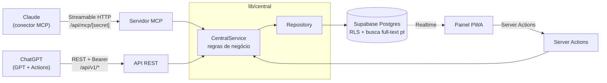
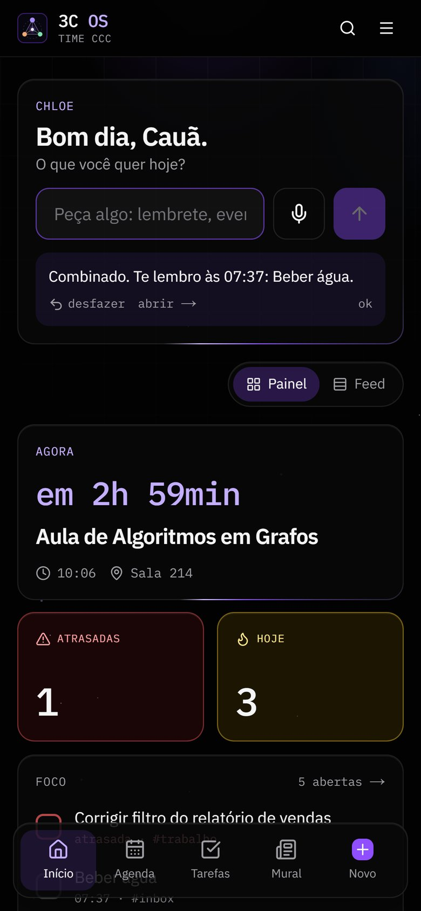
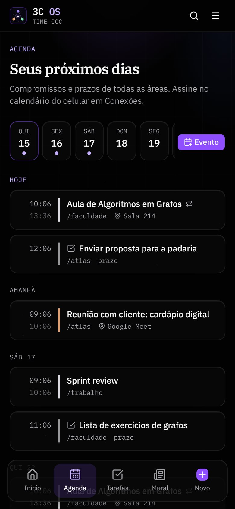
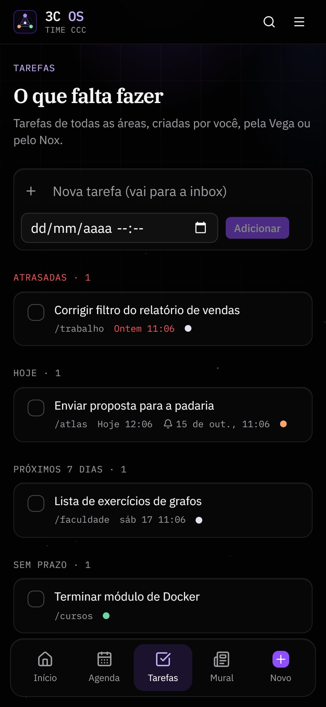
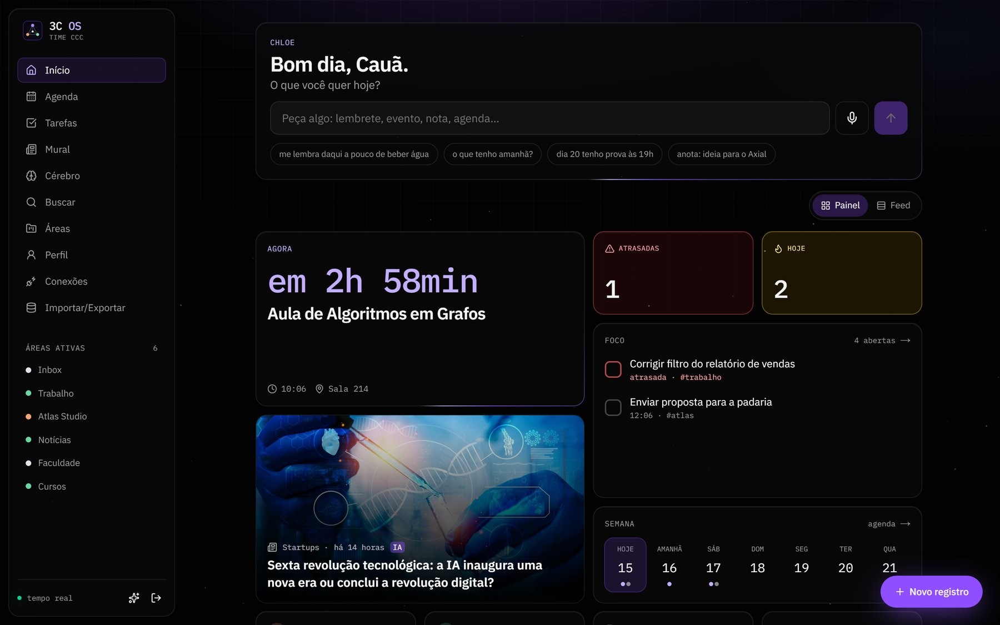
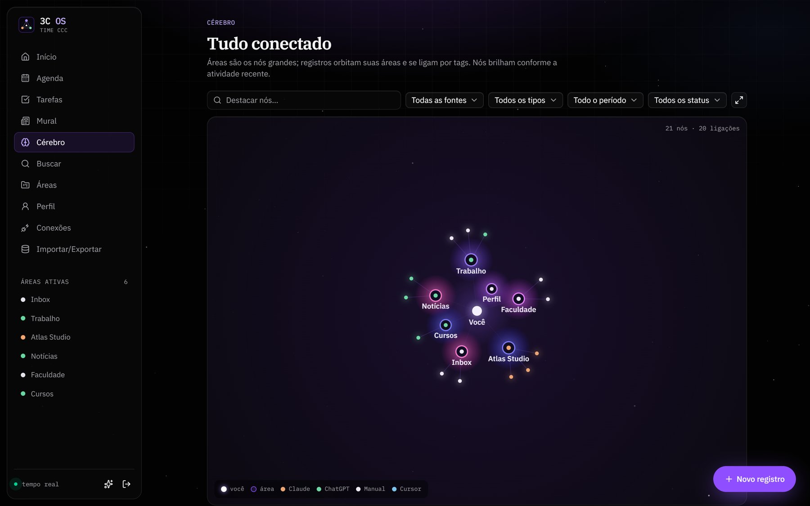
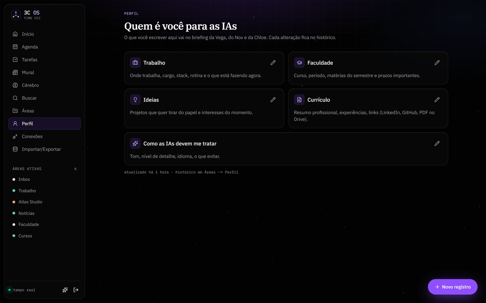

<div align="center">

# 3C OS

<sub>Chloe · Claude · ChatGPT. Antes chamado Central 3C.</sub>

**O ambiente pessoal do Time CCC.**
Memória compartilhada entre Claude e ChatGPT, agenda, tarefas, lembretes e um Mural, lidos e escritos por mim e pelas duas IAs na hora.

[](https://nextjs.org)
[](https://supabase.com)
[](https://modelcontextprotocol.io)
[](https://www.typescriptlang.org)
[](#stack)

**[central3c-caua.netlify.app](https://central3c-caua.netlify.app)** (acesso restrito ao dono)

Evolução de 18/10: [guia de uso](docs/guia-3c.md), [relatório técnico](docs/relatorio-tecnico-2026-10-18.md), [matriz T01–T26](docs/matriz-aceitacao.md) e [operação/recuperação](docs/operations/release-recovery.md). O host Vercel é mantido durante a transição dos consumidores.

</div>

## O problema

Uso Claude e ChatGPT todo dia, e cada um vivia com metade do contexto. A tentativa anterior era uma pasta no Google Drive:

- o conector do Drive no Claude não edita documentos existentes, então tudo virava um "handoff" manual;
- uma tarefa agendada de madrugada tentava resumir o dia, mas rodava num chat novo, sem ver as conversas do dia, e concluía que "não havia nada para atualizar".

## A solução

Um app próprio que é a **fonte única de contexto**. Cada IA lê e grava direto nele, no momento em que algo acontece:

- **Claude** conecta por um **servidor MCP remoto** (conector personalizado no claude.ai, web e app).
- **ChatGPT** conecta por um **GPT personalizado com Actions** (OpenAPI), que lê e grava inclusive no app do celular.
- **Painel web** responsivo e instalável (PWA) para eu ver e editar tudo, com o feed atualizando ao vivo quando uma IA grava.

Cada **área** (projeto, trabalho, disciplina, curso) tem um **resumo vivo**, o documento canônico sempre atualizado, e uma **linha do tempo de registros** com decisões, progresso e contexto. Toda escrita guarda a versão anterior, então qualquer edição de IA pode ser desfeita.

## Arquitetura



- **Uma camada de serviço** (`lib/central`) concentra toda a regra: slugs, criação automática de área, versões, truncamento e briefing. MCP, REST e painel só chamam essa camada.
- **Uma tabela de operações** (`lib/central/operations.ts`) define cada operação uma vez: nome da ferramenta MCP, `operationId`, rota REST, schema Zod e descrição. O servidor MCP, o roteador REST e o `openapi.json` são gerados dela.
- **Repository** abstrai a persistência: Supabase em produção e uma implementação em memória nos testes.
- **Tempo real**: o painel assina o Supabase Realtime. Quando Claude ou ChatGPT gravam, o registro entra no feed e um "sinal" percorre a tela até ele.

## Telas

<sub>Prints do modo demo, com dados fictícios.</sub>

<p align="center">
  
  &nbsp;
  
  &nbsp;
  
</p>

<p align="center">
  
</p>

<p align="center">
  
  &nbsp;
  
</p>

## Funcionalidades

| | |
| --- | --- |
| **Chloe** | assistente no topo do Início: "Bom dia, Cauã. O que você quer hoje?" Entende pedidos em português por texto ou voz ("me lembra daqui a pouco de…", "dia 20 tenho prova às 19h", "o que tenho amanhã?", "anota…", "me avise quando o monitor entrar em promoção") e executa na hora, com desfazer. Com uma chave gratuita de IA, entende pedidos livres e delega para Vega e Nox ([arquitetura](docs/chloe-arquitetura.md)) |
| **Início** | Painel em blocos (agora, atrasadas, hoje, foco com check rápido, notícia em destaque, semana, Vega, Nox, inbox, vigias de preço, carrossel de notícias) e o feed completo ao vivo com filtros por fonte, autor e área |
| **Agenda e tarefas** | eventos com recorrência, tarefas com prazo e prioridade, grupos (atrasadas, hoje, semana, sem prazo, vigias de preço) e lembretes por push, Telegram e e-mail, além de resumo diário às 7h |
| **Mural e notícias** | posts das IAs e notícias coletadas por RSS, ordenadas pelos seus interesses, com leitor dentro do app e "Ler traduzida em português" para fontes em inglês |
| **Perfil** | trabalho, faculdade, ideias, currículo e como as IAs devem te tratar; vai no briefing de todas as IAs |
| **Cérebro** | grafo de força interativo (canvas): áreas, registros e ligações por tags; nós brilham com a atividade e partículas correm quando há escrita nova |
| **Área** | resumo vivo editável em markdown com preview, linha do tempo, status, fixar e arquivar |
| **Busca** | full-text em português (`websearch_to_tsquery`), filtros por área e tipo; `Ctrl/Cmd + K` ou `/` abrem a paleta de comandos |
| **Histórico** | todas as versões de um resumo ou registro, com restauração reversível |
| **Conexões** | URL do conector MCP, URL do OpenAPI, API key mascarada e instruções prontas para colar |
| **Dados** | exportação em JSON e em Markdown (.zip), importação de `.md` ou texto colado |
| **PWA** | instalável no Android e iOS, login por magic link (e por código de 6 dígitos quando há SMTP próprio) |

## Ferramentas para as IAs

| MCP (Claude) | REST (ChatGPT) | O que faz |
| --- | --- | --- |
| `obter_briefing` | `GET /briefing` | perfil, preferências, áreas ativas e registros recentes |
| `listar_areas` | `GET /areas` | lista áreas com filtro por status e tipo |
| `ler_area` | `GET /areas/{slug}` | resumo vivo + últimos registros |
| `ler_registro` | `GET /entries/{id}` | conteúdo completo de um registro |
| `buscar` | `GET /search` | busca full-text com filtros de área, tipo e período |
| `salvar_registro` | `POST /entries` | cria registro (e a área, se não existir) |
| `atualizar_resumo` | `PUT /areas/{slug}/summary` | substitui o resumo vivo guardando a versão anterior |
| `editar_registro` | `PATCH /entries/{id}` | edita ou arquiva um registro |
| `ver_agenda` | `GET /agenda` | eventos e prazos de um período |
| `listar_tarefas` | `GET /tasks` | tarefas pendentes, concluídas ou todas |
| `ver_noticias` | `GET /news` | notícias coletadas, ordenadas pelos interesses |

Quando Vega ou Nox salvam algo com a tag `alerta` ou prioridade alta, o celular recebe a notificação em até 5 minutos (fluxo usado pelo [vigia de preços](docs/vigia-precos.md)).

As leituras são enxutas de propósito: conteúdo longo vem truncado com `truncado: true` e listas são paginadas, porque as IAs têm limite de tamanho de resposta.

## Stack

- **Next.js 16** (App Router, Cache Components, `proxy.ts`) + **TypeScript** estrito
- **Tailwind CSS 4**, **shadcn/ui** (Radix), **Motion**, **cmdk**, **react-force-graph-2d**
- **Supabase**: Postgres, Auth (magic link + OTP), Realtime, RLS, `tsvector` com dicionário `portuguese`
- **MCP**: `mcp-handler` 2 + `@modelcontextprotocol/server` (SDK v2), Streamable HTTP stateless
- **Zod 4**: um schema por operação, reaproveitado por MCP, REST, OpenAPI (`z.toJSONSchema`) e painel
- **Vitest** para serviço, autenticação, API e MCP
- **Vercel Hobby** + **Supabase Free**: custo zero, com cron diário para o Supabase não pausar

## Rodando localmente

```bash
npm install
cp .env.example .env.local
npm run secrets        # gera API_KEY, MCP_SECRET e CRON_SECRET
npx supabase link --project-ref <ref> && npx supabase db push
npm run db:seed
npm run dev
```

O passo a passo completo, incluindo deploy e a conexão no claude.ai e no ChatGPT, está em [docs/setup.md](docs/setup.md).

```bash
npm test               # Vitest
npm run lint
npm run build
npx @modelcontextprotocol/inspector --cli http://localhost:3000/api/mcp/<MCP_SECRET> --transport http --method tools/list
```

## Decisões técnicas

- **Segredo no caminho do MCP** (`/api/mcp/[secret]`, comparado em tempo constante): é o jeito mais simples de autenticar um conector pessoal no claude.ai sem OAuth. A rota já passa um `AuthInfo` adiante, então trocar por OAuth na v2 é substituir essa checagem pelo `withMcpAuth` do `mcp-handler`.
- **GPT com Actions em vez de conector MCP no ChatGPT**: no plano Plus, conectores MCP personalizados não gravam e não funcionam no celular.
- **Fim dos GPTs em 11/12/2026**: a OpenAI está trocando GPTs por plugins, e as Actions não migram. O substituto oficial é um servidor MCP, que o 3C OS já tem (o mesmo do Claude). Em out/2026, porém, o plano Plus ainda não libera as ferramentas de plugins com MCP próprio no chat; quando liberar, basta criar o plugin apontando para a mesma URL do conector. Até lá, o GPT com Actions segue como caminho de leitura e escrita.
- **SDK MCP v2** (`@modelcontextprotocol/server`): é a linha estável atual e a exigida pelo `mcp-handler` 2. Serve a spec 2026-07-28 e cai para Streamable HTTP stateless em clientes mais antigos.
- **Versões gravadas pela camada de serviço**, não por trigger: ficam testáveis e registram a fonte correta (Claude, ChatGPT ou manual).
- **Ferramenta extra `ler_registro`**: como as leituras truncam conteúdo longo, a IA precisa de um caminho para o texto completo.
- **Multiusuário no futuro**: o acesso passa pela tabela `members` e por RLS, e o serviço recebe o repositório por injeção. Virar multiusuário é adicionar `owner_id` e trocar o segredo por OAuth.
- **Rate limit em memória** por IP: suficiente para uso pessoal; cada instância serverless mantém o próprio contador.
- **Login por código além do link**: no iPhone, o link do e-mail abre no Safari, fora do PWA instalado; o código resolve. No Supabase Free o template com código exige SMTP próprio, então o link é o padrão.

## Estrutura

```
app/
  (app)/            páginas autenticadas do painel
  api/mcp/[secret]  servidor MCP
  api/v1/           API REST + openapi.json
  api/cron/         lembretes, resumo diário, notícias e keepalive
lib/central/        schemas, operações, serviço e repositórios
lib/chloe/          regras em português, roteador de modelos e ferramentas da Chloe
lib/news/           coleta RSS, ranking por interesses e tradução
supabase/           migrations, config de auth e template de e-mail
docs/               setup, plano e instruções para as IAs
tests/              Vitest
```

## Licença

© 2026 Cauã Moreira. Código aberto sob a [GNU AGPL-3.0](LICENSE): você pode estudar, usar e modificar, mas quem distribuir ou colocar online uma versão modificada precisa publicar o código dela sob a mesma licença. Para outro tipo de uso, fale comigo.

As versões publicadas até 15/10/2026 continuam valendo sob a licença MIT original.
